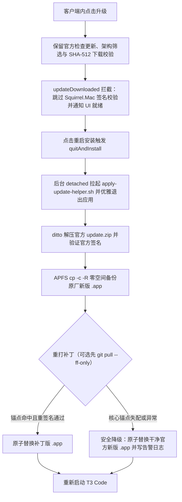

# t3code-enhancer

面向 macOS 版 [T3 Code](https://github.com/pingdotgg/t3code) 的零依赖 `app.asar` 功能增强补丁集，聚焦于主题 CSS 能力边界之外的界面与交互增强，并内置**官方客户端内一键升级自动重打补丁**闭环。

## 核心功能

### 1. 编辑框下方三段式遥测状态栏（DeepSeek Harness 风格）

无缝嵌入编辑框下方的原生上下文栏（`[data-slot="composer-context-strip"]`）中间空白区域，高度、字号、图标与 Hover 主题高亮（`--app-theme-accent-surface`）与原生 `main` 分支按钮完全对齐，支持任意内置与第三方深浅主题：

* **会话统计与输出速率**：显示 `N 轮 M 步 · xx tok/s`。流式生成期间采用混合模式按末尾字符增量实时估算（`~xx tok/s`），回合结束或收到正式统计后切换为精确值；悬停弹出「**会话统计**」卡片，展示模型用时、工具调用用时、首字平均（TTFT）、输出速度（TPS）与当前模型。
* **用量与步级实时缓存命中**：聚合当前会话所有 `providerTurns` 的真实用量，并在运行期按步级 `tokenUsage` 实时累加（Claude Code / Codex / OpenCode 使用原生步级事件，Antigravity 由服务端增量读取 `transcript.jsonl` 桥接至原生 `tokenUsage`）。底栏实时显示总用量与累计缓存命中（token 加权）；悬停弹出「**用量统计**」卡片，展示累计命中（provider 显式上报 TTL 时附带热/冷倒计时）、本步命中、步均命中、上轮命中、未缓存输入、缓存读取、缓存写入、输出、思考输出与估算费用。
* **上下文占用进度环与一键压缩**：以圆形进度环展示当前上下文占用百分比（≥80% 琥珀色、≥90% 红色）；悬停弹出「**上下文已用**」卡片，含彩色分段进度条、缓存/非缓存/剩余明细、自动压缩阈值，以及直接调用原生 `/compact` 的「**压缩上下文**」按钮。

### 2. 流式工作组自动展开、固定高度与内联红绿 Diff

对应 [pingdotgg/t3code#37599](https://github.com/pingdotgg/t3code/discussions/37599)：

* **活跃分组自动展开，结束恢复折叠**：对话运行期间自动展开活跃工作组（`work-live` / `thinking`）；回合结束后自然回归原生折叠态，保持时间线整洁。
* **保留前置步骤可见，仅限定单条展开视口**：不锁死整个工作组高度，组内前面已完成的命令标题始终清晰可见；仅将当前展开的思考/工具详情面板限制为固定最大高度（默认 `300px`，保留原有缩进与柔和边框），并在内容撑高或流式输出时自动滚到底部（鼠标向上滚动立即暂停跟底，滚回底部自动恢复）。
* **最新条目自动聚焦**：新步骤到达时自动展开最新一条并收起前一条，用户手动展开或收起的条目始终保持优先。
* **文件编辑内联红绿 Diff**：展开 `file_change` 条目时复用内置 Query 缓存按需加载变更详情，自动补齐 `+N -M` 行数并直接内联渲染红绿 Diff（同时保留原生「打开差异」按钮）。
* **底栏一键开关**：在编辑框下方提供轻量无边框的「自动展开 / 自动折叠」切换按钮，即时生效并持久化至 `localStorage`。

### 3. 客户端内一键升级自动重打补丁闭环

修改 `app.asar` 并重签名后，原生 `Squirrel.Mac` 会因新旧 `.app` 签名身份不一致而拒装更新。本工具通过轻量 Hook `MacUpdater` 形成无感升级闭环：



## 快速开始

### 1. 只读体检与自测（不修改本机应用）

```bash
# 运行完整端到端无侵入自测（在临时 APFS 副本上完成打包、语法校验、运行时自测与降级保护校验）
node test/dry-run-check.mjs

# 对本机 T3 Code 执行只读锚点体检
./install.sh --dry-run
```

### 2. （推荐）一次性创建本地固定代码签名证书

如果不配置证书，默认采用 ad-hoc 签名（`-`），每次重装或自动升级后都会更换签名哈希，导致 macOS 反复弹出钥匙串密码授权框。运行一次下方脚本在登录钥匙串创建 10 年期自签名代码签名证书（`T3 Code Local Patch`）：

```bash
./scripts/setup-signing-cert.sh
```

此后 `./install.sh` 与自动升级脚本都会自动优先使用该固定证书签名，仅首次打开点一次「始终允许」，后续重装和升级永久免弹窗。

### 3. 安装补丁

在系统终端执行（若 T3 Code 正在运行，脚本会自动提示并优雅退出，安装完成后自动重新打开）：

```bash
./install.sh
```

* 首次安装会自动通过 APFS `cp -c -R`（写时复制，几乎零额外磁盘占用）将官方原厂签名应用完整备份至 `~/.t3/enhancer/backups/`。
* 后续更新本仓库后直接重跑 `./install.sh`，会自动基于同版本干净原厂备份重新打最新补丁并原子替换，不残留旧补丁。

### 4. 一键还原官方原厂签名版

在系统终端执行（同样会自动检测、退出运行中的 T3 Code，还原完成后自动重新打开）：

```bash
./uninstall.sh
```

## 配置与多设备同步

配置文件位于 `~/.t3/enhancer/config.json`：

```json
{
  "repoDir": "/path/to/t3code-enhancer",
  "appPath": "/Applications/T3 Code (Nightly).app",
  "autoPullOnUpdate": false,
  "signingIdentity": "auto",
  "features": {
    "composerStatus": true,
    "liveExpand": true,
    "macUpdaterHook": true
  },
  "composerStatus": {
    "enabled": true,
    "density": "compact",
    "rateMode": "hybrid"
  },
  "liveExpand": {
    "enabled": true,
    "fixedHeightPx": 300,
    "onlyLatestEntry": true,
    "showToggleButton": true
  }
}
```

* **`signingIdentity`**：默认 `"auto"`，自动检测并使用本地钥匙串中的 `T3 Code Local Patch` 证书，未找到时回退 ad-hoc 签名（`"-"`）。
* **`autoPullOnUpdate`**：设为 `true` 时，在客户端内自动升级重打补丁前会自动执行一次非阻塞 `git pull --ff-only`，便于多台 macOS 设备同步补丁更新。
* **`liveExpand.fixedHeightPx`**：单条展开内容区的最大高度（像素，默认 `300`），修改后重跑 `./install.sh` 即刻生效。

## 工程设计原则

* **零第三方依赖**：纯 Node.js 标准库实现 ASAR 解析、流式重打包、分块 SHA-256 `integrity` 计算与 `Info.plist` 同步更新；未安装系统 `node` 时自动降级使用应用内置的 `ELECTRON_RUN_AS_NODE=1`。
* **Hash 无关 & 变量名无关**：严禁写死构建产物文件名哈希或压缩局部变量名，全部按语义特征动态定位目标 chunk 并用正则动态捕获压缩标识符。
* **React Compiler 安全**：不破坏上游组件内生成的 `c(N)` memo 槽位缓存与依赖索引；状态栏以数据层单点桥接 + 独立轻量 DOM 挂载实现，零常驻全树 `MutationObserver`、零空闲轮询、Hover 卡片懒渲染。
* **分模块独立降级**：模块 A / B / C 互不强绑定。自动升级重打时，非核心模块锚点失配仅单独跳过并记录告警，其余模块正常生效；若核心更新器 Hook 失配则整包安全回退至干净官方新版。

## 目录结构

```text
t3code-enhancer/
├── README.md
├── install.sh                    # 一键安装 / 基于原厂备份原子重打补丁
├── uninstall.sh                  # 一键还原至完整官方签名 .app
├── scripts/
│   ├── asar-lib.mjs              # 零依赖 ASAR 读写、分块 SHA-256 校验与 Info.plist 更新
│   ├── config.mjs                # 配置管理、应用探测与代码签名封装
│   ├── patch-all.mjs             # 主补丁编排器（--dry-run / --features / --strict-updater）
│   ├── setup-signing-cert.sh     # 一键创建并信任本地固定代码签名证书
│   ├── apply-update-helper.sh    # 升级时后台拉起的解压、备份、重打与降级脚本
│   └── patches/
│       ├── head-runtime.mjs      # index.html 全局样式、运行时总线、状态栏与内联 Diff 渲染
│       ├── live-expand.mjs       # 流式自动展开、单条固定高度滚底与编辑详情按需加载
│       ├── composer-status.mjs   # 当前会话用量、轮次、工具节点与 /compact 单点桥接
│       ├── step-usage-bridge.mjs # 服务端 Antigravity transcript.jsonl 步级缓存/用量实时桥接
│       └── mac-updater-hook.mjs  # MacUpdater 自动升级拦截 Hook
└── test/
    └── dry-run-check.mjs         # 端到端无侵入体检与回归自测套件
```
